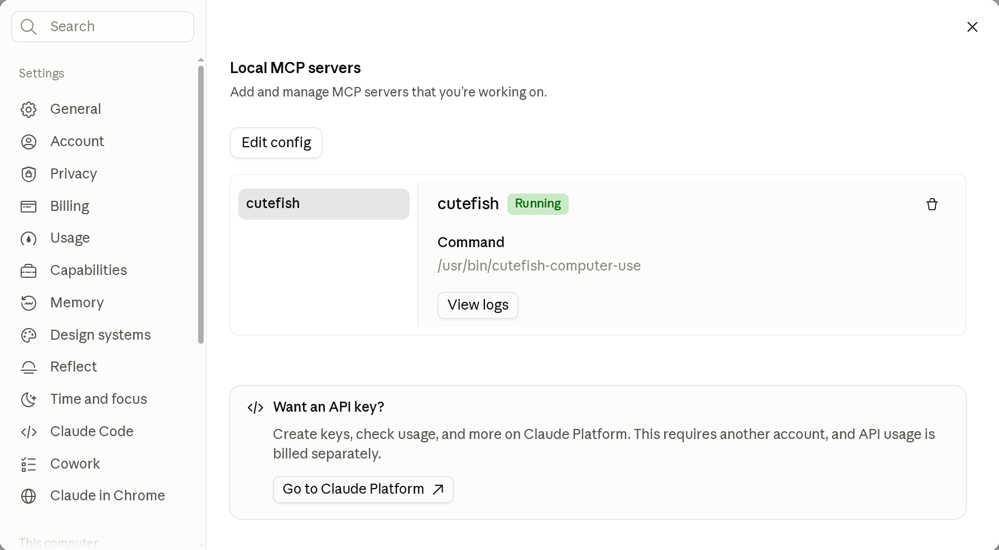
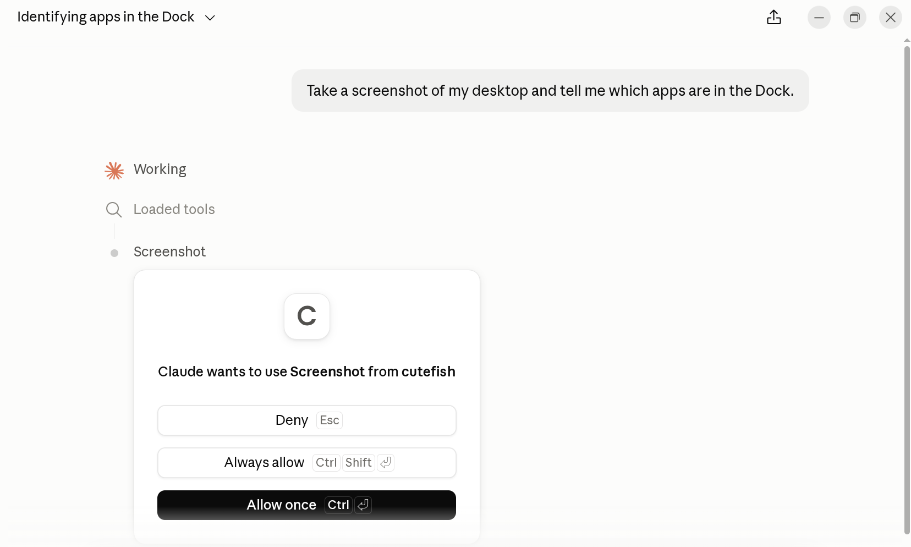
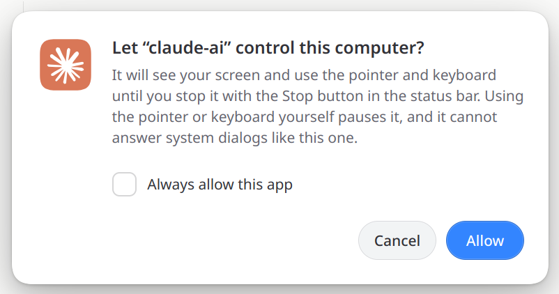
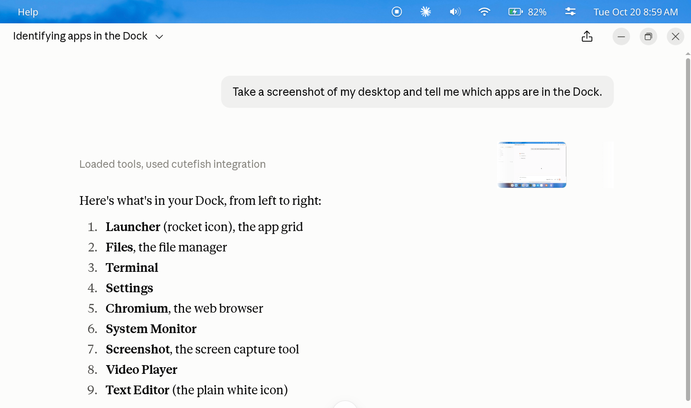

Agents like Claude Code and Codex can already read files and run commands.
With [cutefish-computer-use](https://github.com/cutefishos/cutefish-computer-use)
they can also see the screen, click, type and move windows, so they can work
with graphical applications the way you do. It is an MCP server: any agent app
that supports MCP can use it.

Control goes through cutefish-compositor itself, not a screen recorder and a
fake keyboard. The compositor decides when an agent may act, shows that it is
acting, and stops it the moment you want.

## What keeps you in charge

- **You say yes first.** The first time an agent tries to use the desktop,
  Cutefish asks you. The agent cannot click, type into or fake this dialog.
  It asks again next time, unless you choose to always allow that app;
  **Settings › Privacy** lists those apps and takes them off again.
- **You can always see it, and stop it.** While an agent is in control, a Stop
  button sits in the status bar. Locking the screen stops it too.
- **Your input wins.** Moving the pointer or typing pauses the agent until you
  are done.
- **It cannot answer for you.** Permission prompts, password dialogs and the
  lock screen are off limits to it.
- **Only one program is trusted.** The compositor offers control only to
  `/usr/bin/cutefish-computer-use`, and the screen can only be read while you
  have allowed control.

## Install

cutefish-computer-use comes with Cutefish Desktop. If your system does not
have it yet, install it from the Cutefish repository:

```shell
sudo apt install cutefish-computer-use
```

Then log out and back in: the compositor looks for the server when the session
starts.

## Claude Code, Codex and other command-line agents

Add it as a stdio MCP server. For Claude Code:

```shell
claude mcp add cutefish -- /usr/bin/cutefish-computer-use
```

For Codex, add this to `~/.codex/config.toml`:

```toml
[mcp_servers.cutefish]
command = "/usr/bin/cutefish-computer-use"
```

Other agents take the same command in their MCP settings.

## Claude Desktop

Open **Settings**, then **Developer**, and choose **Edit config**. Add the
server to `claude_desktop_config.json`:

```json
{
  "mcpServers": {
    "cutefish": {
      "command": "/usr/bin/cutefish-computer-use"
    }
  }
}
```

Restart Claude Desktop. The Developer page now lists `cutefish` as running.



## Trying it

Ask for something that needs the screen, such as "Take a screenshot of my
desktop and tell me which apps are in the Dock." Claude Desktop first asks
whether it may use the tool:



Claude Desktop asks this once for each tool. Choose **Always allow** so it does
not ask again; the dialog that decides whether an agent may use your desktop
is the next one, and it comes from Cutefish. In Claude Code, allow
`mcp__cutefish` with `/permissions` for the same effect.

Cutefish then asks whether the agent may control the computer. This dialog
comes from the compositor, not from the agent, and the agent cannot answer
it. Tick **Always allow this app** if you do not want to be asked again:



Once you allow it, the agent sees the desktop and gets to work. The Stop
button in the status bar shows that it is in control; press it whenever you
want it to stop.



## What it can do

- **See:** screenshots of the desktop or of one window, and zoomed views of
  part of the screen.
- **Point:** click, double-click, drag, scroll and hold buttons.
- **Type:** text in any language, key chords and the session's own
  shortcuts.
- **Windows and apps:** list, focus, move, resize and close windows, open
  applications, files and links, and set the clipboard.

Bug reports and ideas are welcome on
[GitHub](https://github.com/cutefishos/cutefish-computer-use/issues).
