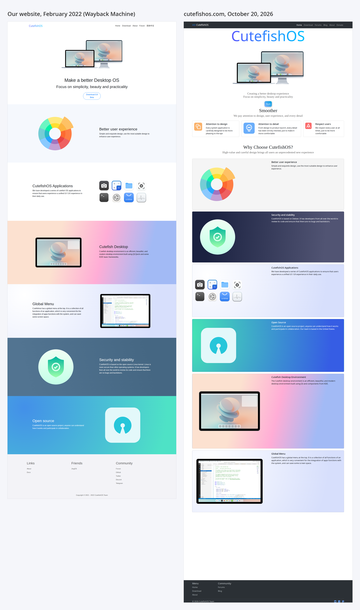
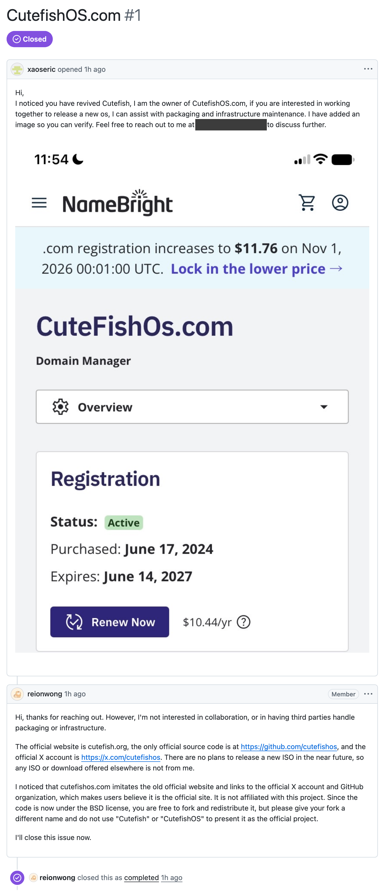
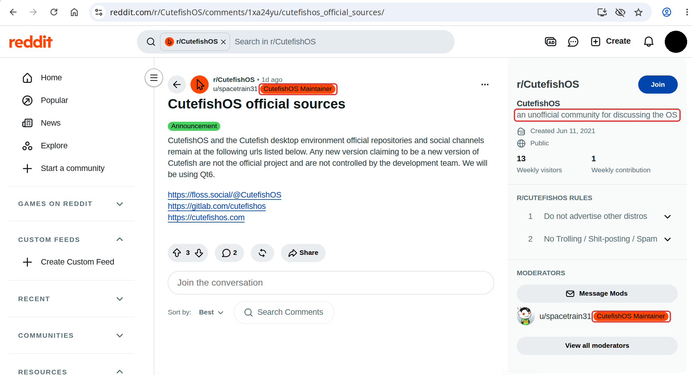

Cutefish used to live at cutefishos.com. After development paused in 2022,
that domain lapsed and was later registered by someone outside the project.
The site there today impersonates Cutefish. It presents itself as the
CutefishOS project and signs as a "CutefishOS Team", reuses the text and
images of our old website without permission, and links to forum and social
accounts we have never operated. It is not run by us, and nothing it
distributes is built or endorsed by us.

On the left, our website in February 2022, as the
[Wayback Machine archived it](https://web.archive.org/web/20220205022028/https://en.cutefishos.com/);
on the right, cutefishos.com on October 20, 2026. The product image is the
same file, byte for byte, and the tagline below it is ours. The rest of the
page repeats our sections one by one, with the same pictures and much of the
same text.

Cutefish has not changed hands. It is still developed by the people who
started it, and there is no other development team.

## Official sources

These are the only official places for Cutefish and Cutefish Desktop:

- Website: [cutefish.org](https://cutefish.org)
- Source code: [github.com/cutefishos](https://github.com/cutefishos)
- Packages and ISOs: [download.cutefish.org](https://download.cutefish.org)
- X: [@cutefishos](https://x.com/cutefishos)
- GitHub Sponsors: [github.com/sponsors/cutefishos](https://github.com/sponsors/cutefishos)

Any other website, repository, forum, subreddit or account using the Cutefish
or CutefishOS name is not operated by this project, whatever it says about
itself.

## Releases

There is no official release yet. Nightly packages and ISOs for testing are
published on [download.cutefish.org](https://download.cutefish.org). Both are built in the open by GitHub Actions,
and every file can be checked against its build; see
[How Cutefish packages are built](/blog/how-cutefish-is-built).

If you find a Cutefish or CutefishOS ISO anywhere else, it was not built by
us, and we cannot vouch for what is in it. Only download Cutefish from the
official sources above, and do not install builds of unknown origin.

## Forks

Most of Cutefish is released under the BSD 3-Clause License, and anyone is
free to fork it. We only ask that forks use a different name and do not
present themselves as the official Cutefish or CutefishOS project.

## Archive

For the record, here is the
[GitHub issue](https://github.com/cutefishos/getting-started/issues/1) in which
the current owner of cutefishos.com offered to help with packaging and
infrastructure, and our reply. The screenshot was taken on October 20, 2026;
the email address has been removed.

A [post on r/CutefishOS](https://www.reddit.com/r/CutefishOS/comments/1xa24yu/cutefishos_official_sources/)
titled "CutefishOS official sources" names floss.social/@CutefishOS,
gitlab.com/cutefishos and cutefishos.com as the official channels. It was not
posted by us. Cutefish has never had an account on floss.social or a group
on GitLab, and cutefishos.com has not been ours since 2022.

