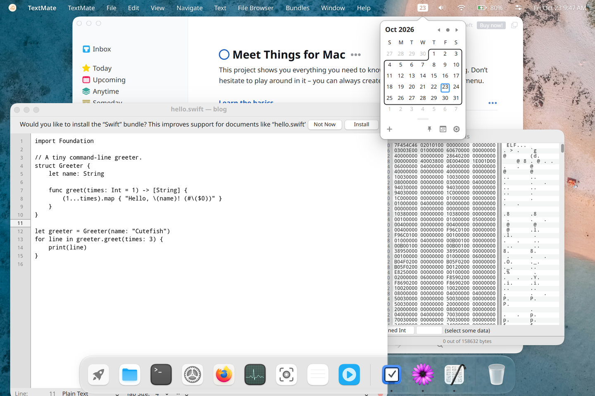
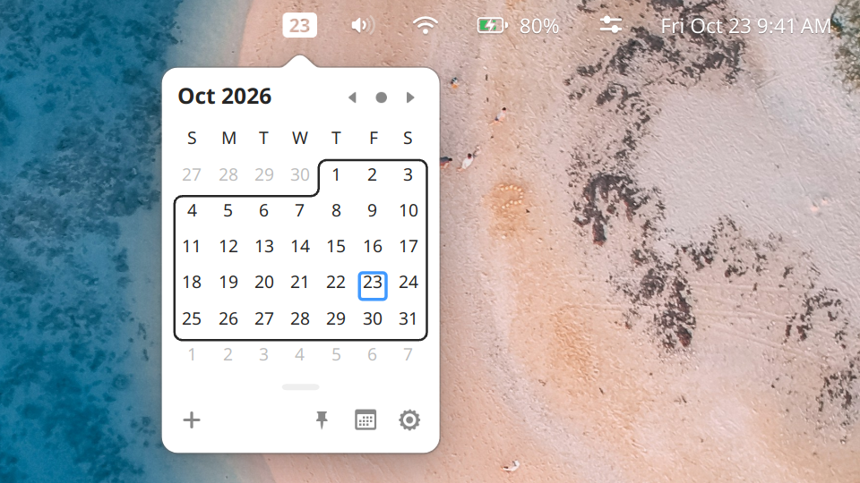
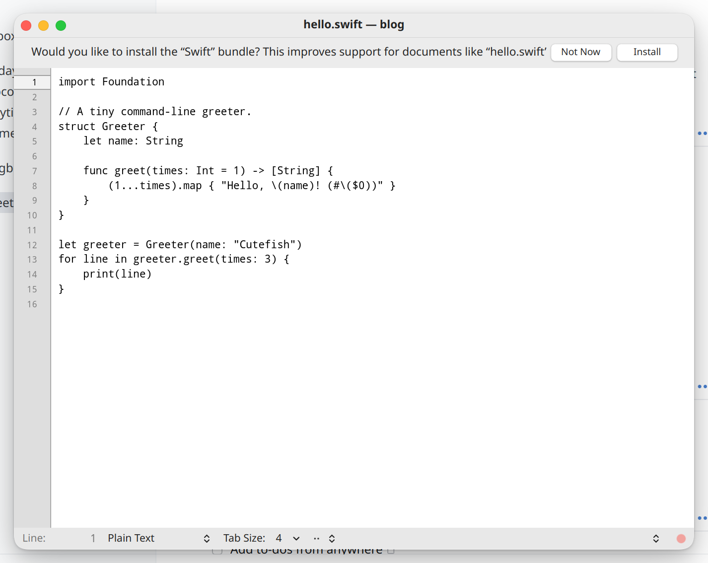
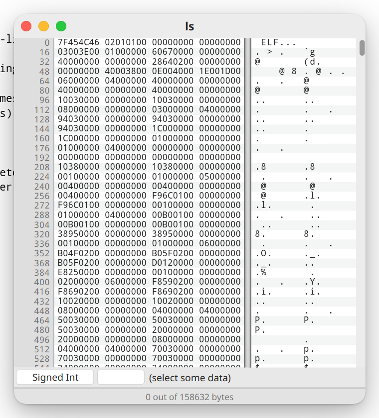
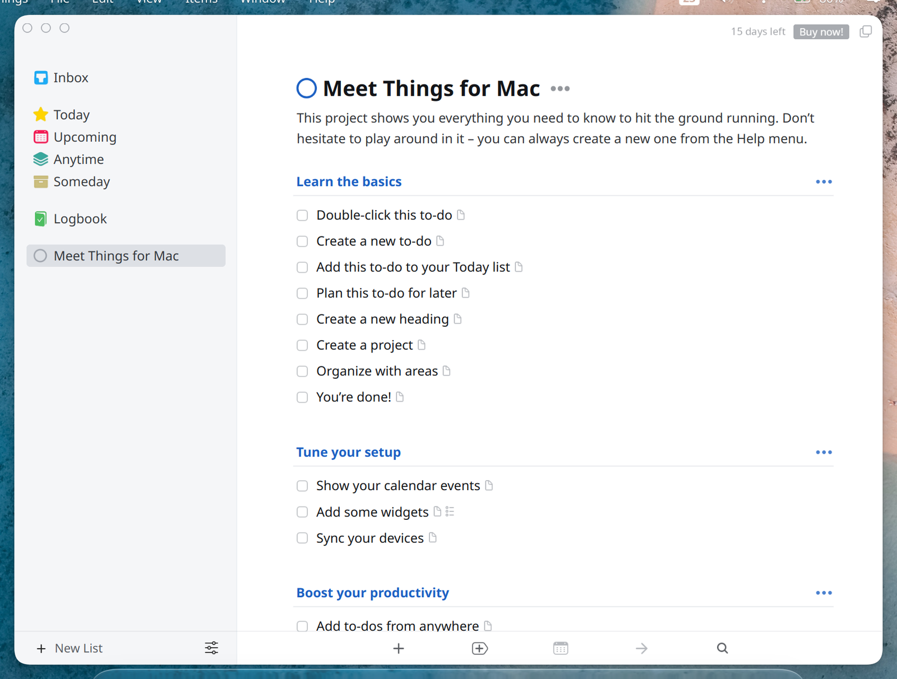
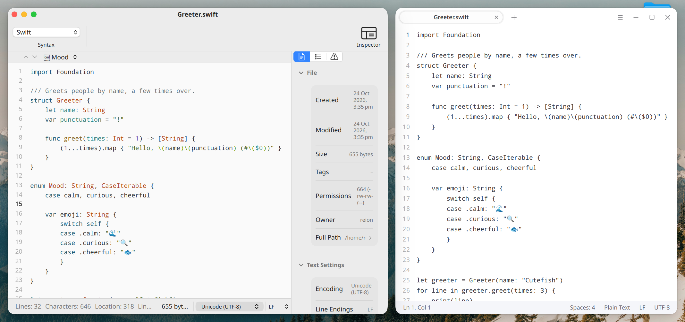

Cutefish will be able to run apps made for the Mac. Not just regular apps
with windows, but also the small menu bar apps that sit next to the clock.
A Mac app on Cutefish opens in a normal window, puts its menus in our menu
bar and shows up in the Dock, like any other app on the desktop.

Every app in this screenshot is a Mac app. We did not modify or recompile
any of them for Linux. They are the same downloads a Mac user would get.

## Why this is hard

A Mac app does very little on its own. To open a window, show a menu, draw
a line of text or work out what day it is, it calls into macOS: AppKit for
windows and controls, Foundation for text, dates and files, Core Graphics
for drawing, SwiftUI for newer interfaces, and dozens of other frameworks.

None of that exists on Linux. To run a Mac app we have to provide all of it
ourselves, and it has to behave the way macOS does. When our answer is even
slightly off, the app lays out its window wrong, draws nothing, or crashes.

In practice that means writing our own version of a large part of macOS's
programming interfaces. We call it Reef. It is over 300,000 lines of code
across more than 70 frameworks, and AppKit and Foundation alone are over
70,000 lines each. Underneath sit a loader for Mac programs (they use a
different binary format, Mach-O), an Objective-C runtime, support for Swift
and a low-level system library. Even so, this covers only part of macOS,
which has tens of thousands of these functions.

## How we work

Nobody knows exactly which parts of macOS a given app needs, so we can't
write everything up front. We go app by app. We run a real Mac app and look
at where it breaks: a missing function, a window drawn wrong, a button that
does nothing. Then we work out what a Mac does there, implement it as a
general feature rather than a fix for that one app, add a test, and run the
app again.

Each app makes the next one easier, since apps share most of what they use.
But how much is left is genuinely unknown. The next app can always reach
for something nobody has used yet.

Some of what we run into:

- A drop-down and the label beside it should share a text baseline. We
  measured the baseline from a slightly different edge than macOS does, and
  the drop-downs in settings windows sat a few points off their labels.
- macOS tints an image automatically when its name ends in "Template". We
  didn't, and one app's window buttons came out as thick black rings.
- Asking for a redraw while a window is being prepared for drawing
  shouldn't trigger another one. In our code it did, and an idle window was
  redrawing more than a hundred times a second.
- Apps check which version of macOS they're on and change their behaviour,
  so every version difference is a decision for us.
- Newer apps use SwiftUI, whose internals Apple doesn't publish. We build
  it from the documentation and compare our output with a real Mac, pixel
  by pixel.

## Part of the desktop

Mac apps use the same building blocks as every other Cutefish app. Our
graphics toolkit draws their windows, text and controls. Our compositor
gives them the same shadows, outlines and animations as other windows, and
their menus get the same glass. Our shell puts their menus in the Cutefish
menu bar, their icons in the Dock and their entries in the launcher.

Menu bar apps were the real test. On a Mac, Itsycal draws a small icon with
the date in the menu bar and drops a calendar from it when you click.
Cutefish has status item support designed for exactly this: the app draws
its own item at whatever width it needs, and its popup opens right
underneath it.

## What runs

Itsycal works completely: the date in the status bar, the calendar popup,
the right-click menu and the settings window.

TextMate, the text editor, and Hex Fiend, the hex editor, open and edit
files. Below, Hex Fiend is looking at a Linux program. CotEditor, a newer
editor built partly with SwiftUI, opens, edits and saves files, with its
syntax colouring, inspector, find panel and settings working.

Things 3, the to-do app, runs, and parts of it are drawn by our own SwiftUI.
It isn't finished yet.

## How fast it is

Reef doesn't emulate a processor or translate instructions. A Mac app's own
code runs directly on your CPU, the same way a Linux program does. What
costs time is the part we wrote: our AppKit, Foundation and SwiftUI have to
do the work macOS does for the app, and they are much younger than Apple's.

To see where we stand, we compared CotEditor, a Mac text editor built with
AppKit and SwiftUI, with Cutefish's own text editor on the same laptop. Both
open the same files and get the same input.

| | CotEditor on Reef | Cutefish Text Editor |
|---|---|---|
| Start to first frame | 235 ms | 115 ms |
| Open a 4,000-line file | 0.36 s | 0.12 s |
| Open a 20,000-line file | 0.50 s | 0.12 s |
| Key press to the letter on screen | 21 ms | 18 ms |
| CPU time to type 80 characters | 1.4 s | 0.17 s |
| Time to draw a frame while scrolling | 4.4 ms | 1.2 ms |
| Time to draw a frame while resizing the window | 3.8 ms | 1.2 ms |
| Scrolling and live window resizing | 60 fps | 60 fps |

What you feel is close: text appears within a few milliseconds of the
native editor, files open in well under a second, and scrolling and
resizing keep up with the screen. What you don't see is the work behind it.
CotEditor still uses several times the CPU to get there, which costs
battery.

When this post first went up, typing 80 characters took 1.9 s of CPU time,
a scrolling frame took 6.0 ms and a frame of live resizing 7.3 ms, with two
frames drawn for every step of the resize. Since then:

- Scrolling moves the pixels already on screen and draws only the strip
  that comes into view, instead of redrawing all the visible text.
- Our SwiftUI keeps the parts of a view that didn't change, and keeps
  their measured sizes, instead of rebuilding and measuring the whole tree.
- Typing redraws only the lines a change touches, and work handed between
  background threads wakes far fewer of them.
- Resizing draws one frame per step, and no longer measures every menu
  item of every toolbar pop-up on each frame. It uses less than half the
  CPU it did.

The rest of the gap is mostly the app's own work: CotEditor lays out three
nested split views and wraps its text again for every new window width,
and it asks for some of its redraws itself. These were problems in our
code, not limits of the approach, and we're still working on them.

## What won't work

Anything that goes through Apple's servers is out of reach. That includes
the App Store. A Mac app on Cutefish can't sell you a subscription or an
in-app purchase, and one you bought on a Mac won't carry over. Apps sold
only in the Mac App Store can't be installed at all, because the download
is tied to an Apple account. We need a version from the developer's own
website.

iCloud is the same. Sign in with Apple doesn't work, and an app that syncs
through iCloud keeps its data on your computer.

If an app sells licences on its own website or syncs through its own
service, none of this applies.

## Where the code comes from

Reef is our own code. It doesn't use code from Darling or from Wine. We
don't take apart or copy Apple's closed macOS software, and we don't use
Apple's developer kit. When we need to know how something should behave,
we read Apple's documentation, look at what the app is asking for, and
compare with the same app running on a Mac.

We do build on the parts of its platform that Apple releases as open
source. These are included in Reef under their own licences:

- Core Foundation, from
  [swift-corelibs-foundation](https://github.com/swiftlang/swift-corelibs-foundation)
  (Apache 2.0)
- Grand Central Dispatch, which apps use to run work in the background, from
  [swift-corelibs-libdispatch](https://github.com/swiftlang/swift-corelibs-libdispatch)
  (Apache 2.0)
- the Swift standard library and runtime, from
  [swiftlang/swift](https://github.com/swiftlang/swift) (Apache 2.0)
- LZFSE, Apple's compression format, from
  [lzfse/lzfse](https://github.com/lzfse/lzfse) (BSD 3-Clause)

We also read objc4, dyld, xnu and Libc from
[apple-oss-distributions](https://github.com/apple-oss-distributions) to
understand how the Mac behaves, without copying from them. Reef's
Objective-C runtime and loader are our own. Reef also includes LLVM's
libc++, libc++abi and libunwind, SQLite, curl and Tcl. Thanks to everyone
behind these projects.

## Darling and Wine

[Darling](https://www.darlinghq.org/) is the best-known project for running
macOS software on Linux, and [Wine](https://www.winehq.org/) has done the
same for Windows apps for decades. Wine isn't an emulator. It reimplements
the Windows programming interfaces, and Reef takes the same approach for the
Mac, so "Wine for Mac apps" is a reasonable way to think about it.

The difference is mostly scope. Darling aims to run macOS software in
general. It is well ahead of us on command-line tools and the system layer
underneath, and it works on any Linux desktop. Wine runs a huge range of
Windows software across Linux desktops. Reef only targets graphical Mac
apps, only on Cutefish, and is built around Cutefish's own toolkit,
compositor and shell. Command-line tools aren't something we're aiming for.

We have a lot of respect for what both communities have built.

## Is it open source?

Not for now. This is a large investment and a feature that sets Cutefish
apart, and it needs to be protected while it grows. Opening it later is
possible, for example once community sponsorship can sustain the work.

## What's next

More apps and more of SwiftUI, so that modern Mac apps work, and after that
a web engine, which many apps depend on. We'll write again when there's
more to show.
